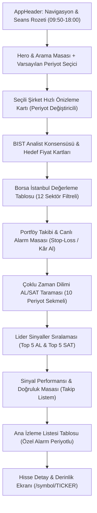
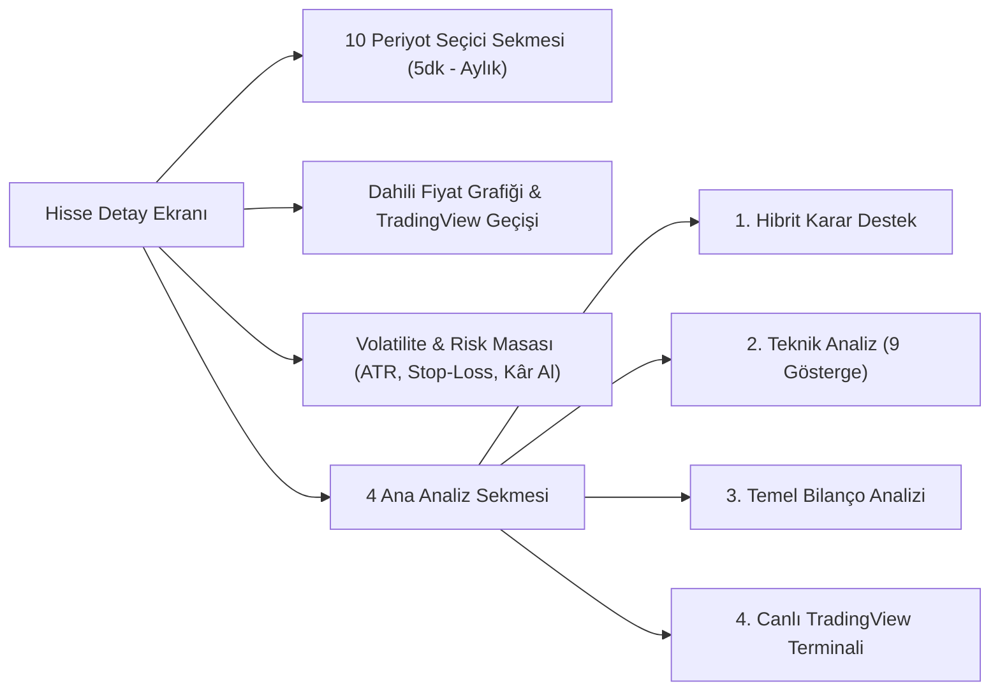

# Borsa İstanbul (BIST) Menüsü Kapsamlı Kullanım Kılavuzu & Ekran Bölümleri Rehberi

> Bu kılavuz, Finans Asistanı platformunun **Borsa İstanbul (BIST)** menüsündeki tüm ekran bölümlerini, analitik masalarını, göstergelerini ve desteklenen tüm zaman dilimlerini (periyotları) ayrıntılı olarak açıklamaktadır.

---

## 📑 İçindekiler Tablosu

1. [Genel Bakış & BIST Karar Motoru Mimarisi](#1-genel-bakış--bist-karar-motoru-mimarisi)
2. [Desteklenen Analiz Periyotları (Zaman Dilimleri) & Ağırlıklandırma Sistemi](#2-desteklenen-analiz-periyotları-zaman-dilimleri--ağırlıklandırma-sistemi)
3. [BIST Menüsündeki Tüm Ekran Bölümleri](#3-bist-menüsündeki-tüm-ekran-bölümleri)
   - [Bölüm 1: Üst Navigasyon & BIST Canlı Seans Göstergesi (`AppHeader`)](#bölüm-1-üst-navigasyon--bist-canlı-seans-göstergesi-appheader)
   - [Bölüm 2: Hero & BIST Hızlı Arama Masası (`#search-section`)](#bölüm-2-hero--bist-hızlı-arama-masası-search-section)
   - [Bölüm 3: Seçili Şirket Hızlı Önizleme & Analiz Kartı (`SelectedCompanyPreview`)](#bölüm-3-seçili-şirket-hızlı-önizleme--analiz-kartı-selectedcompanypreview)
   - [Bölüm 4: BIST Analist Konsensüsü & Hedef Fiyat Kartları (`BistAnalystHighlights`)](#bölüm-4-bist-analist-konsensüsü--hedef-fiyat-kartları-bistanalysthighlights)
   - [Bölüm 5: Borsa İstanbul Hisseleri & Değerleme Tablosu (`BistValuationTable`)](#bölüm-5-borsa-istanbul-hisseleri--değerleme-tablosu-bistvaluationtable)
   - [Bölüm 6: Portföy Pozisyon Takibi & Canlı Alarm Masası (`PositionTracker`)](#bölüm-6-portföy-pozisyon-takibi--canlı-alarm-masası-positiontracker)
   - [Bölüm 7: Çoklu Zaman Dilimi AL/SAT Taraması (`TimeframeSignals`)](#bölüm-7-çoklu-zaman-dilimi-alsat-taraması-timeframesignals)
   - [Bölüm 8: Lider Sinyaller Sıralaması (Top AL & SAT) (`TopSignals`)](#bölüm-8-lider-sinyaller-sıralaması-top-al--sat-topsignals)
   - [Bölüm 9: Sinyal Performansı & Takip Listesi Masası (`TrackListTable`)](#bölüm-9-sinyal-performansı--takip-listesi-masası-tracklisttable)
   - [Bölüm 10: Ana İzleme Listesi Tablosu (`WatchlistTable`)](#bölüm-10-ana-izleme-listesi-tablosu-watchlisttable)
   - [Bölüm 11: BIST Hisse Detay & Derinlik Ekranı (`/symbol/[ticker]`)](#bölüm-11-bist-hisse-detay--derinlik-ekranı-symbolticker)
   - [Bölüm 12: BIST Ayarları & Çift Yönlü Senkronizasyon (`/ayarlar` & `bist-settings.md`)](#bölüm-12-bist-ayarları--çift-yönlü-senkronizasyon-ayarlar--bist-settingsmd)
4. [Yatırımcı Tipleri İçin Stratejik Periyot Matrisi & Senaryolar](#4-yatırımcı-tipleri-için-stratejik-periyot-matrisi--senaryolar)
5. [Sıkça Sorulan Sorular (SSS)](#5-sıkça-sorulan-sorular-sss)

---

## 1. Genel Bakış & BIST Karar Motoru Mimarisi

Finans Asistanı BIST Terminali, **Borsa İstanbul Pay Piyasası**'nda işlem gören tüm şirketleri (BIST 30, BIST 100 ve BIST TÜM kapsamındaki 800+ hisse) teknik indikatörler, bilanço temel rasyoları ve kurumsal analist konsensüsü ile çok boyutlu olarak analiz eden yapay zeka destekli bir karar destek platformudur.

### 🏛️ Veri Kaynakları & Seans Dinamikleri
- **Canlı & Gecikmeli Fiyat Akışı:** Borsa İstanbul seans saatleri boyunca (**09:50 - 18:00 TSİ**) sürekli güncellenir.
- **Resmi BIST Endeks Bültenleri:** `borsaistanbul.com` günlük CSV bültenleri ile BIST 30, BIST 50, BIST 100, Katılım Endeksi (XK100/XKTUM) ve Temettü Endeksi (XTMTU) bileşenleri periyodik doğrulanır.
- **Kurumsal Analist Konsensüsü:** İş Yatırım, Garanti BBVA Yatırım, Ak Yatırım, Yapı Kredi Yatırım ve küresel aracı kurumların 12 aylık hedef fiyatları ve getiri potansiyelleri entegredir.

### ⚖️ Karar Skorlama Motoru (-1.00 ile +1.00 Aralığı)
Her BIST hissesi için hesaplanan Nihai Karma Skor, teknik analiz puanı ile temel analiz puanının seçilen zaman dilimine göre ağırlıklı ortalaması alınarak üretilir:

| Sinyal | Karma Skor Eşiği | Anlamı ve Yatırımcı Aksiyonu |
|:---:|:---:|:---|
| 🟢 **AL** | `Skor ≥ +0.25` | Trend güçlü yükselişte, indikatörler boğa bölgesinde ve temel rasyolar destekleyici. Yeni alım veya pozisyon büyütme için uygundur. |
| 🟡 **TUT** | `-0.25 < Skor < +0.25` | Yön nötr, piyasa konsolidasyonda veya indikatörler çelişkili. Mevcut pozisyon korunabilir, yeni giriş için net teyit beklenmelidir. |
| 🔴 **SAT** | `Skor ≤ -0.25` | Trend aşağı yönlü, ayı piyasası baskısı hakim veya değerleme aşırı pahalı. Kâr realizasyonu, zararı kesme (Stop-Loss) veya nakde geçiş önerilir. |

---

## 2. Desteklenen Analiz Periyotları (Zaman Dilimleri) & Ağırlıklandırma Sistemi

Finans Asistanı, her yatırımcının işlem tarzına hitap etmek amacıyla **10 farklı zaman dilimini (periyodu)** destekler. Platformun en kritik özelliklerinden biri **Dinamik Zaman Dilimi Ağırlıklandırması (Timeframe-Adaptive Scoring)** sistemidir.

### ⏱️ Periyot Karşılaştırma & Dinamik Ağırlık Tablosu

Mum periyodu küçüldükçe fiyat hareketlerini mikro likidite ve anlık momentum belirler; dolayısıyla temel analiz ağırlığı azaltılır, teknik analiz ağırlığı %95'e kadar yükseltilir. Mum periyodu büyüdükçe şirketin kârlılığı, özsermayesi ve çarpanları baskın hale gelir; bu nedenle temel analizin ağırlığı %65'e kadar çıkar.

| Periyot Kodu | Görünen Adı | Mum Süresi | Geçmiş Veri (Bar/Pencere) | Teknik Ağırlık (%) | Temel Ağırlık (%) | Hedef Yatırımcı & Stratejik Kullanım |
|:---:|:---:|:---:|:---:|:---:|:---:|:---|
| `5m` | **5 Dakikalık** | 5 Dakika | Son 7 Gün | **%95** | **%5** | **Scalping & Hızlı Gün İçi:** Seans içinde anlık mikro tepkiler, ani haber akışı kırılımları ve hızlı giriş-çıkışlar. |
| `10m` | **10 Dakikalık** | 10 Dakika | Son 14 Gün | **%95** | **%5** | **Hızlı Gün İçi Salınım:** 5 dakikalıktaki gürültüyü filtreleyen ve erken momentum yakalayan scalperlar. |
| `15m` | **15 Dakikalık** | 15 Dakika | Son 20 Gün | **%90** | **%10** | **Standart Gün İçi (Day Trading):** Otomatik e-posta tarama tetikleyicisinin baz periyodu; seans içi trend dönüşlerini en net gösteren periyot. |
| `30m` | **30 Dakikalık** | 30 Dakika | Son 30 Gün | **%90** | **%10** | **Dengeli Seans Analizi:** Gün içi kritik destek/direnç seviyeleri ve öğle/kapanış seansı pozisyonlanması. |
| `1h` | **1 Saatlik** | 60 Dakika | Son 45 Gün | **%80** | **%20** | **Kısa Vadeli Swing:** Gün içi dalgalanmalardan etkilenmeden 1-3 günlük hareketleri yakalamak isteyen yatırımcılar. |
| `2h` | **2 Saatlik** | 120 Dakika | Son 60 Gün | **%80** | **%20** | **Seanslık Ana Yön:** BIST seansını 4 ana muma bölen, sabah-öğle-akşam döngüsünü netleştiren ara periyot. |
| `4h` | **4 Saatlik** | 240 Dakika | Son 90 Gün | **%70** | **%30** | **Güçlü Swing Trading:** Günlük grafiğe en yakın ara trend; sahte kırılımları engellemek için ideal teyit periyodu. |
| `1d` | **Günlük (Varsayılan)** | 1 Gün | Son 365 Gün (1 Yıl) | **%60** | **%40** | **Ana Trend & Klasik Yatırım:** BIST'in ana omurgası. Birkaç haftalık veya aylık pozisyonlar için temel ve teknik dengesi kurulur. |
| `1wk` | **Haftalık** | 1 Hafta | Son 730 Gün (2 Yıl) | **%45** | **%55** | **Orta-Uzun Vade:** Haftalık kapanışlar, kurumsal fon girişleri ve bilanço trendlerinin ana yönü. |
| `1mo` | **Aylık** | 1 Ay | Son 1460 Gün (4 Yıl) | **%35** | **%65** | **Makro Değer Yatırımı:** Warren Buffett tarzı uzun vadeli değerleme, enflasyon üzeri getiri ve sektör döngüleri. |

> [!NOTE]
> **Çoklu Zaman Dilimi Hiyerarşisi:** Profesyonel piyasa pratiğinde üst zaman dilimi (örneğin `1d` Günlük) **ana yönü**, alt zaman dilimi (örneğin `15m` veya `1h`) ise **işleme giriş zamanlamasını** belirler. Günlük grafiği AL veren bir hissenin 15 dakikalık grafikte aşırı satım bölgesinden AL vermesi en yüksek başarı oranlı giriş fırsatıdır.

---

## 3. BIST Menüsündeki Tüm Ekran Bölümleri

Finans Asistanı'nda üst navigasyonda yer alan **🇹🇷 Borsa İstanbul** sekmesine tıklandığında (veya doğrudan `/` adresine gidildiğinde) BIST terminali açılır. Bu ekranda 10 adet ana bileşen/masa bulunmaktadır. Aşağıda her bir bölümün işlevi, kontrolleri ve adım adım kullanım rehberi sunulmuştur:



---

### Bölüm 1: Üst Navigasyon & BIST Canlı Seans Göstergesi (`AppHeader`)

#### 🎯 Amacı ve İşlevi
Kullanıcının platformun tüm piyasaları ve modülleri arasında hızlıca gezinmesini, BIST piyasasının anlık seans durumunu izlemesini ve klavye kısayoluyla tek tuşla hisse aramasını sağlar.

#### 🎛️ İçerdiği Kontroller & Göstergeler
1. **Brand Logo & Ana Sayfa Butonu:** Tek tıkla BIST ana kontrol paneline döner.
2. **Evrensel BIST Arama Çubuğu (`BistCombobox` - `⌘K` / `Ctrl+K`):** Klavye kısayoluyla açılır; hisse kodu (`THYAO`, `GARAN`) veya şirket unvanı (`Türk Hava Yolları`, `Ereğli`) yazılarak doğrudan hisse detay sayfasına yönlendirir.
3. **Piyasa Navigasyon Sekmeleri:**
   - 🇹🇷 **Borsa İstanbul (BIST)**: Aktif menü (`/`).
   - 🥇 **Emtia & Döviz**: Altın, gümüş, döviz ve petrol terminali.
   - 🪙 **Kripto Para**: 7/24 kesintisiz kripto terminali.
   - 🇺🇸 **Amerikan Borsası**: S&P 500 ve Nasdaq terminali.
   - ⚡ **TradingView Terminali**: Özel TradingView çoklu grafik terminali.
4. **BIST Canlı Seans Durum Rozeti:**
   - **09:50 - 18:00 TSİ** arasında yeşil yanıp sönen animasyonla `BIST: Seans Açık` rozeti görünür.
   - Hafta sonları ve seans dışı saatlerde gri `BIST: Seans Kapalı` rozetine döner.
5. **Hızlı Masa Kısayolları:**
   - 📖 *Kullanım Kılavuzu* (`/kullanim-kilavuzu`)
   - 📊 *Teknik Detay* (`/teknik-detay-klavuzu`)
   - 👥 *Canlı Analitik* (`/analitik`)
   - 📌 *İzleme Listesi* (`/takip`)
   - 💼 *Portföy* (`/pozisyonlar`)
   - ⚙️ *Ayarlar* (`/ayarlar`)

---

### Bölüm 2: Hero & BIST Hızlı Arama Masası (`#search-section`)

#### 🎯 Amacı ve İşlevi
BIST ana sayfasının en üstünde yer alan karşılama ve filtreleme alanıdır. Kullanıcının 800+ BIST şirketi arasından anında arama yapmasını, varsayılan inceleme periyodunu belirlemesini ve en popüler 10 BIST şirketine tek tıkla ulaşmasını sağlar.

#### 🎛️ İçerdiği Kontroller & Kullanımı
1. **Varsayılan Analiz Periyodu Seçici (`TimeframeSelector`):**
   - Açılır kutuda tüm periyotlar (`5m`, `10m`, `15m`, `30m`, `1h`, `2h`, `4h`, `1d`, `1wk`, `1mo`) mevcuttur.
   - Buradan seçilen periyot, sistemdeki `timeframe-settings.md` dosyasına kaydedilir ve hem anasayfadaki hızlı hisse önizlemesinde hem de şirket detayına tıklandığında varsayılan açılış periyodu olarak kullanılır.
2. **Arama Kutusu (`BistCombobox`):**
   - Yazmaya başladığınızda BIST veritabanındaki şirketleri (kod, tam unvan ve sektör bilgisiyle) listeler.
   - Seçilen şirket sayfayı terk etmeden hemen alttaki *Önizleme Kartı*na yüklenir.
3. **Hızlı Erişim Çipleri (Quick Chips):**
   - En çok takip edilen 10 BIST lokomotif şirketi hazır buton olarak sunulur:
     `THYAO` · `ASELS` · `GARAN` · `EREGL` · `BIMAS` · `TUPRS` · `KCHOL` · `SISE` · `AKBNK` · `FROTO`
   - Bu butonlardan herhangi birine tıklandığında, anında ilgili hissenin analizi yapılır ve önizleme kartı açılır.

---

### Bölüm 3: Seçili Şirket Hızlı Önizleme & Analiz Kartı (`SelectedCompanyPreview`)

#### 🎯 Amacı ve İşlevi
Arama kutusundan veya hızlı erişim çiplerinden bir hisse seçildiğinde açılan dinamik karttır. Sayfayı değiştirmeden hissenin o anki teknik ve temel durumunu, seçilen periyottaki AL/SAT sinyalini ve önemli gerekçelerini özetler.

```
┌────────────────────────────────────────────────────────────────────────┐
│  ● SEÇİLİ ŞİRKET ANALİZ ÖZETİ  [ 1 Saatlik ]        [Periyot: 1S ▼] [X]│
├────────────────────────────────────────────────────────────────────────┤
│  THYAO  Türk Hava Yolları                       [  AL  ]               │
│  ₺312.50  (+2.45%)                              Nihai Skor: +0.62      │
│                                                 Teknik: +0.70 · Temel: +0.50
├────────────────────────────────────────────────────────────────────────┤
│  Öne Çıkan Teknik Sinyaller    Öne Çıkan Temel Rasyolar   Analist Hedefi│
│  • Supertrend AL bölgesinde    • F/K: 4.8 (Sektör altı)   ₺420.00       │
│  • RSI (14): 58.2 (Pozitif)    • PD/DD: 0.95 (İskontolu)  Potansiyel:   │
│  • EMA 20 > EMA 50 Kesişimi    • ROE: %28.4               +34.4% (AL)   │
├────────────────────────────────────────────────────────────────────────┤
│  [ + Takip Listeme Ekle ]        [ Detaylı Grafik & Analiz Sayfasına Git → ]
└────────────────────────────────────────────────────────────────────────┘
```

#### 🎛️ Adım Adım Kullanımı
1. **Periyot Değiştirici:** Sağ üst köşedeki periyot butonundan periyodu değiştirdiğinizde (örneğin `1d` iken `15m` yaptığınızda), hissenin 15 dakikalık mum verileri çekilir, teknik göstergeler yeniden hesaplanır ve sinyal anında güncellenir.
2. **Skor ve Ayrışım:** Kart üzerinde *Nihai Karma Skor*, *Salt Teknik Puan* ve *Temel Bilanço Puanı* ayrı ayrı gösterilir.
3. **Öne Çıkan 3 Teknik & 3 Temel Madde:** En yüksek puan getiren indikatör gerekçeleri (örneğin RSI aşırı satım toparlanması, MACD boğa kesişimi) ve rasyolar listelenir.
4. **Analist Hedef Fiyatı:** Kurumsal konsensüs hedef fiyatı ve getiri potansiyeli kutucukta yer alır.
5. **Takip Listeme Ekle (TrackList):** Bu butona tıklandığında hisse, o anki fiyatı, seçili periyodu ve sinyaliyle birlikte *Sinyal Performansı Masası*na (`TrackList`) kaydedilir.
6. **Detay Sayfasına Git:** Tıklandığında hissenin çoklu indikatör ve TradingView grafiklerinin yer aldığı `/symbol/[ticker]?tf=...` sayfasına yönlendirilir.

---

### Bölüm 4: BIST Analist Konsensüsü & Hedef Fiyat Kartları (`BistAnalystHighlights`)

#### 🎯 Amacı ve İşlevi
Borsa İstanbul'un lokomotif şirketlerini takip eden yetkili aracı kurum ve yatırım bankalarının (İş Yatırım, Ak Yatırım, Garanti vb.) **12 aylık konsensüs hedef fiyatlarını**, hissenin cari piyasa fiyatına göre sunduğu **getiri potansiyelini (%)** ve şirketin güncel AL/SAT sinyalini vitrin kartları şeklinde sunar.

#### 🎛️ Görünüm Modları & Ayarları
Panelin sağ üst köşesinde iki farklı stratejik görünüm modu bulunur:
1. **🏆 BIST Liderleri Modu:**
   - THYAO, ASELS, GARAN, TUPRS gibi BIST 30'un en yüksek işlem hacimli dev şirketlerinin kartlarını listeler.
2. **🚀 En Yüksek Potansiyel Modu:**
   - BIST havuzunda analistlerin verdiği 12 aylık ortalama hedef fiyata göre cari fiyatı en çok iskonto barındıran (en yüksek yükseliş potansiyeline sahip) 4 şirketi sıralar.
   - *Not: Seçilen mod `bist-settings.md` dosyasına kalıcı olarak kaydedilir.*

#### 📊 Kart Bileşenleri
- **Hisse Kodu & Sektör İkonu:** Şirkete ait özel ikon (ör. THYAO için ✈️, ASELS için 🛡️, GARAN için 🏦).
- **Son Fiyat & Günlük Yüzde Değişim.**
- **Sinyal Rozeti:** Üstte seçili olan periyoda göre canlı AL/SAT/TUT sinyali.
- **Analist Görüşü:** Güçlü AL, AL, TUT, SAT rozetleri ve görüş bildiren analist sayısı (ör. `Güçlü AL · 14 Analist`).
- **Ortalama Hedef Fiyat:** Konsensüs 12 aylık medyan fiyat hedefi (TL).
- **Getiri Potansiyeli (%):** Cari fiyata göre yüzde prim potansiyeli (yeşil veya kırmızı font).

#### 📈 BIST Ekosistemi Özet İstatistikleri Masası
Kartların hemen altında tüm BIST piyasasının nabzını tutan 4 adet metrik kutusu yer alır:
1. **Taranan BIST Şirketleri:** Analiz edilen güncel şirket havuzu sayısı.
2. **🟢 AL Sinyali Verenler:** Teknik ve analist kriterlerine göre pozitif bölgede olan şirket adedi ve toplam içindeki yüzdesi.
3. **🔴 SAT Sinyali Verenler:** Düşüş eğiliminde veya düzeltme sürecinde olan şirket adedi ve yüzdesi.
4. **Ortalama Analist Potansiyeli:** Taranan hisselerin ortalama konsensüs getiri beklentisi (%).

#### ⏱️ Otomatik Yenileme Kontrolü (`AutoRefreshControl`)
Panelin sağ üstündeki yenileme kontrolünden veri yenileme frekansı **15s, 30s, 60s, 120s, 300s veya Kapalı** olarak ayarlanabilir (`bist_analyst_refresh_interval`).

---

### Bölüm 5: Borsa İstanbul Hisseleri & Değerleme Tablosu (`BistValuationTable`)

#### 🎯 Amacı ve İşlevi
Borsa İstanbul şirketlerinin borsa fiyatı, teknik sinyali, analist hedef fiyatları ve temel değerleme çarpanlarını (F/K, PD/DD, ROE) interaktif, filtrelenebilir ve sıralanabilir bir matriste sunan ana değerleme masasıdır.

#### 🎛️ Desteklenen 12 Sektör & Endeks Filtresi
Kullanıcı sekme butonlarına tıklayarak yalnızca ilgilendiği sektördeki hisseleri listeleyebilir. Her sekmenin yanında o sektördeki şirket sayısı parantez içinde dinamik gösterilir:

| Sektör / Endeks | Sistem Kodu | İkon | Temsil Edilen Şirketler & Kapsam |
|:---|:---:|:---:|:---|
| **BIST 30** *(Varsayılan)* | `bist30` | 🏆 | En yüksek piyasa değerine sahip 30 lider şirket (THYAO, ASELS, GARAN vb.). |
| **BIST 100** | `bist100` | 📊 | Gösterge endeks olan 100 büyük şirket. |
| **BIST TÜM** | `all` / `bistall`| 🇹🇷 | Tüm Borsa İstanbul Pay Piyasası kayıtlı şirketleri. |
| **Bankacılık & Finans** | `banka` | 🏦 | AKBNK, GARAN, ISCTR, YKBNK, VAKBN, HALKB, TSKB, sigorta ve finansal kiralama. |
| **Sanayi & Üretim** | `sanayi` | 🏗️ | EREGL, KRDMD, FROTO, TOASO, TTRAK, SISE, ARCLK, CIMSA, AKCNS vb. |
| **Holding & Yatırım** | `holding` | 🏛️ | KCHOL, SAHOL, AGHOL, ALARK, ENKAI, DOHOL, BERA vb. |
| **Enerji & Petrol** | `enerji` | ⚡ | TUPRS, PETKM, ASTOR, AKSEN, ENJSA, CWENE, ENERY, GWIND, ODAS vb. |
| **Havacılık & Lojistik** | `havacilik` | ✈️ | THYAO, PGSUS, TAVHL, RYSAS, CLEBI vb. |
| **Teknoloji & Savunma** | `teknoloji` | 💻 | ASELS, ALTNY, LOGO, MIATK, REEDR, VBTYZ, SDTTR vb. |
| **Perakende & Tüketim** | `perakende` | 🛒 | BIMAS, MGROS, SOKM, CCOLA, AEFES, ULKER, TABGD, MAVI vb. |
| **Telekomünikasyon** | `telekom` | 📡 | TCELL, TTKOM. |
| **GYO & Gayrimenkul** | `gyo` | 🏢 | EKGYO, TRGYO, ISGYO, SNGYO, RGYAS vb. |
| **Diğer** | `diger` | 🌐 | Madencilik, spor kulüpleri, sağlık ve diğer hizmet şirketleri. |

> [!TIP]
> **Açılış Varsayılanı:** Hangi sektör sekmesine tıklarsanız, o sektör otomatik olarak `bist-settings.md` dosyasına ve `localStorage`'a **Açılış Varsayılanı (★)** olarak kaydedilir. Sayfayı yenilediğinizde doğrudan o sektör açık gelir.

#### 🔍 Arama, Sinyal Filtreleme ve Sıralama
1. **İçerik Arama Kutusu:** Kod veya unvan yazılarak listede anında daraltma yapılır (ör. "demir" yazıldığında demir-çelik hisseleri gelir).
2. **Sinyal Butonları:** `TÜMÜ`, `AL`, `TUT`, `SAT` butonlarıyla sadece pozitif veya negatif hisseler filtrelenebilir.
3. **Sıralama Ölçütleri (`SortBy`):**
   - *Yükseliş Potansiyeli:* Analist hedef fiyatına göre en çok getiri vaat edenler en üste.
   - *Nihai Skor (Azalan/Artan):* En güçlü teknik/temel puana sahip olanlar.
   - *Günlük Değişim (%):* Günün en çok kazandıranları/kaybettirenleri.
   - *Fiyat/Kazanç (F/K - P/E):* En düşük çarpanlı ucuz şirketler.
   - *Piyasa Değeri / Defter Değeri (PD/DD):* İskontolu hisseler.
   - *Özsermaye Kârlılığı (ROE):* Sermayesini en verimli işleten kârlı şirketler.
   - *Hisse Kodu:* Alfabetik sıralama.
4. **Görünüm Modu Değiştirici:**
   - 📱 **Kart Görünümü:** Mobil cihazlar veya kompakt görünüm için kutulu kart dizilimi.
   - 💻 **Tablo Görünümü:** Geniş ekranlarda tüm sütunların tek satırda görüldüğü profesyonel terminal modu.

---

### Bölüm 6: Portföy Pozisyon Takibi & Canlı Alarm Masası (`PositionTracker`)

#### 🎯 Amacı ve İşlevi
Yatırımcının elinde bulunan BIST hisselerini, alış maliyetini, işlem tarihini ve **hedef periyodunu** sisteme kaydederek canlı kâr/zarar takibi yapmasını sağlar. En önemli fonksiyonu, fiyat **Stop-Loss (🛑 Zararı Kes)** veya **Take-Profit (🎯 Kâr Al)** seviyelerine ulaştığında arka planda **otomatik e-posta alarmı** göndermesidir.

```
┌──────────────────────────────────────────────────────────────────────────────────┐
│  💼 Portföy Pozisyon Takibi & Canlı Alarm Masası             [+ Pozisyon Ekle]  │
├──────────────────────────────────────────────────────────────────────────────────┤
│  THYAO (1S Periyot)  · Alış: ₺305.00 · Güncel: ₺312.50 · Net K/Z: +%2.46 (+₺7.50) │
│  🛑 Stop-Loss: ₺295.00 (-%3.28)    🎯 Kâr Al: ₺330.00 (+%8.20)     [Alarm: Aktif]│
└──────────────────────────────────────────────────────────────────────────────────┘
```

#### 🎛️ Otomatik Seviye Hesaplama ve Periyot Bağıntısı
Yeni bir pozisyon eklenirken hisse kodu ve işlem periyodu (ör. `1h` veya `4h`) seçildiğinde, sistem arka planda o periyodun **ATR (Average True Range)** volatilite değerini analiz eder ve otomatik olarak önerilen seviyeleri kutucuklara doldurur:
- **Önerilen Stop-Loss (🛑):** Seçilen periyodun volatilitesine göre teknik destek altı (ör. Fiyat - 1.5x ATR).
- **Önerilen Take-Profit (🎯):** Risk/Ödül rasyosu 1:2 veya 1:3 olacak şekilde direnç hedefi.
- Kullanıcı isterse bu değerleri elle serbestçe değiştirebilir.

#### 📧 Otomatik E-Posta Kontrol Sıklığı
- Panel üzerinden veya `/ayarlar` menüsünden **1 dk, 5 dk, 15 dk, 30 dk, 1 saat veya Kapalı** seçenekleri belirlenebilir (`position-settings.md`).
- Seans açıkken arka plan zamanlayıcısı portföydeki hisseleri bu sıklıkla denetler; fiyat tanımlanan Stop-Loss veya Kâr Al çizgisini geçtiği anda alıcılara acil alarm e-postası iletilir.
- **Şimdi Kontrol Et** butonu ile anında manuel denetim tetiklenebilir.

---

### Bölüm 7: Çoklu Zaman Dilimi AL/SAT Taraması (`TimeframeSignals`)

#### 🎯 Amacı ve İşlevi
Tüm BIST hisselerini aynı anda **10 farklı periyotta** tarayarak hangi hissenin hangi zaman diliminde AL veya SAT verdiğini kategorize eden, platformun en kapsamlı tarama motorudur.

#### 🎛️ Periyot Sekmeleri
Üst kısımdaki sekme çubuğunda 11 seçenek bulunur:
- **Tümü (Özet):** Tüm periyotlardan gelen en güçlü sinyallerin konsolide özeti.
- **5dk (`5m`)**, **10dk (`10m`)**, **15dk (`15m`)**, **30dk (`30m`)**
- **1S (`1h`)**, **2S (`2h`)**, **4S (`4h`)**
- **Günlük (`1d`)**, **1H (`1wk`)**, **1A (`1mo`)**

Bir sekmeye tıklandığında (örneğin `15dk`), BIST hisselerinin o periyottaki mum grafiği indikatörleri taranır.

#### 🧠 3 Farklı Sinyal Analiz Modu
Panelin sağ üst köşesinden sinyal değerlendirme mantığı değiştirilebilir:
1. **Hibrit Karar Destek:** Teknik indikatörler ile temel bilanço rasyolarının seçilen periyot ağırlığına göre birleşimi (Önerilen).
2. **Salt Teknik Sinyaller:** Şirket bilançosunu tamamen göz ardı ederek yalnızca Supertrend, RSI, MACD, Stochastic RSI ve Hareketli Ortalamaları baz alır (Gün içi scalperlar için uygundur).
3. **Salt Temel Değerler:** Fiyat grafiğini göz ardı ederek yalnızca F/K, PD/DD, ROE, Net Borç/FAVÖK ve Cari Oran üzerinden puanlama yapar (Uzun vadeli değer yatırımcıları için uygundur).

#### 📊 Yeşil & Kırmızı Sinyal Alanları
- **Yeşil Alan (AL Sinyalleri):** Seçilen periyotta pozitif skor alan hisseler, puan sırasına göre dizilir. Kartta hisse kodu, son fiyat, değişim %, puan ve sinyali üreten indikatör gerekçesi (ör. `Supertrend AL + RSI 54`) yer alır.
- **Kırmızı Alan (SAT Sinyalleri):** Negatif bölgedeki hisseler listelenir.

#### 📧 Otomatik E-Posta Raporlama Entegrasyonu
- Üst bantta sistemin `mail-settings.md` yapılandırması görüntülenir.
- **15 dk Otomatik / Seanslık:** Seans saatleri içinde her 15 dakikada bir (veya ayarlanan sıklıkta) bu tarama otomatik yürütülür ve e-posta listesine özet bülten gönderilir.
- **Şimdi Tara & Mail Gönder Butonu:** Zamanlayıcıyı beklemeden o saniyede BIST hisselerini tarar ve anında e-posta raporu iletir.

---

### Bölüm 8: Lider Sinyaller Sıralaması (Top AL & SAT) (`TopSignals`)

#### 🎯 Amacı ve İşlevi
Piyasa genelindeki gürültüyü eleyerek seçilen periyotta **en yüksek puana sahip ilk 5 hisseyi (En Güçlü AL)** ve **en düşük puana sahip ilk 5 hisseyi (En Güçlü SAT)** yan yana iki elit kartta sunar.

```
┌───────────────────────────────────────┬───────────────────────────────────────┐
│  ▲ EN GÜÇLÜ AL SİNYALLERİ (TOP 5)    │  ▼ EN GÜÇLÜ SAT SİNYALLERİ (TOP 5)   │
├───────────────────────────────────────┼───────────────────────────────────────┤
│  #1 THYAO  ₺312.50 (+2.5%) Skor: +0.84│  #1 HEKTS  ₺3.80 (-3.1%)  Skor: -0.78 │
│     Supertrend AL · T:+0.90 F:+0.75   │     Supertrend SAT · T:-0.85 F:-0.65  │
│  #2 ASELS  ₺62.40  (+1.8%) Skor: +0.76│  #2 SASA   ₺4.15 (-2.4%)  Skor: -0.71 │
│  #3 GARAN  ₺118.20 (+1.2%) Skor: +0.71│  #3 CANTE  ₺16.20 (-1.9%) Skor: -0.65 │
│  #4 TUPRS  ₺145.00 (+0.9%) Skor: +0.68│  #4 GUBRF  ₺168.00 (-1.5%) Skor: -0.60│
│  #5 EREGL  ₺28.40  (+1.4%) Skor: +0.64│  #5 ODAS   ₺6.50 (-1.2%)  Skor: -0.58 │
└───────────────────────────────────────┴───────────────────────────────────────┘
```

#### 🎛️ Periyot ve Endeks Seçimi
- **Periyot Seçici (`TimeframeSelector`):** `5m`'den `1mo`'ya kadar periyot değiştirilebilir. Örneğin `15m` seçildiğinde gün içi liderler, `1d` seçildiğinde günlük ana trend liderleri listelenir (`timeframe-settings.md` üzerinden saklanır).
- **Endeks Tipi Seçici (`IndexTypeSelector`):**
  - **BIST 30:** Yalnızca likit 30 hisse arasından en güçlüleri seçer.
  - **BIST 100:** BIST 100 evrenindeki liderleri sıralar.
  - **BIST TÜM:** Tüm borsa genelinde tarama yapar.
- **Skor Kırılımı:** Her satırda `T: +0.8` (Teknik Skor) ve `F: +0.6` (Temel Skor) ayrıntısı verilerek hissenin teknikten mi yoksa bilançodan mı güç aldığı açıkça belirtilir.

---

### Bölüm 9: Sinyal Performansı & Takip Listesi Masası (`TrackListTable`)

#### 🎯 Amacı ve İşlevi
Finans Asistanı'nın ürettiği sinyallerin doğruluğunu ve kârlılığını şeffaf bir şekilde test eden "Sinyal Geriye Dönük Performans (Backtest / Forward Test)" masasıdır.

#### 🎛️ Çalışma Mantığı
1. Kullanıcı gerek hisse önizleme kartından gerek hisse detay sayfasından **"Takibe Al"** butonuna bastığında:
   - O anki hisse kodu (ör. `GARAN`),
   - İşlem tarihi ve saati,
   - O an incelenen **Mum Periyodu** (ör. `1h` veya `1d`),
   - Sistemin o an ürettiği **Sinyal** (`AL` veya `SAT`),
   - Ve o anki **Kayıt Fiyatı** sisteme kaydedilir.
2. Bu masada, o günden bugüne hissenin fiyatının nereye gittiği canlı fiyatla kıyaslanır:
   - **Net Getiri / Değişim (%):** `(Güncel Fiyat - Kayıt Fiyatı) / Kayıt Fiyatı`
   - **Başarı Durumu:** AL sinyali verilen bir hisse yükselmişse yeşil kâr rozeti, düşmüşse kırmızı zarar rozeti gösterilir.
3. Böylece kullanıcı, sistemin 15 dakikalık periyotta mı yoksa günlük periyotta mı daha yüksek başarı sağladığını kendi gözleriyle doğrular.

---

### Bölüm 10: Ana İzleme Listesi Tablosu (`WatchlistTable`)

#### 🎯 Amacı ve İşlevi
Doğrudan kullanıcının `watchlist.md` dosyasında kayıtlı olan favori hisselerini listeler. Kullanıcının tüm BIST yerine yalnızca kendi ilgilendiği hisseleri tek bir ekranda canlı izlemesine olanak tanır.

#### 🎛️ Bağımsız Hisse Başına Alarm Periyodu Seçimi
Bu tablonun en benzersiz kabiliyeti, **her hisse için ayrı bir sinyal ve e-posta alarm periyodu** atanabilmesidir:
- Örneğin listenizdeki `THYAO` için açılır kutudan **15 Dakikalık (`15m`)** periyot seçebilirsiniz (böylece THYAO gün içi scalp sinyallerine göre taranır).
- Aynı listedeki `EREGL` için **Günlük (`1d`)** periyot seçebilirsiniz (EREGL sadece ana trend kırılımlarında alarm üretir).
- Bu tercihler doğrudan `watchlist.md` dosyasına satır bazında yazılır ve sistemin otomatik e-posta tarayıcısı her hisseyi kendi atanmış periyoduna göre denetler.

#### 📋 Tablo Özellikleri
- **Kategori Filtresi:** Tümü, BIST (🇹🇷), Emtia & FX (🥇), Kripto (🪙), ABD (🇺🇸).
- **Hızlı Hisse Ekleme:** Arama kutusundan kod yazılarak veya önerilen butonlara basılarak yeni BIST hissesi listeye eklenebilir.
- **Sütunlar:** Varlık Kodu & Adı, Son Fiyat & Günlük Değişim, Sinyal Rozeti & Nihai Skor, Karar Kriterleri (RSI, Supertrend, MACD durumları), Özel Alarm Periyodu Seçici, Hisse Detay Linki ve Silme (Çöp Kutusu) Butonu.

---

### Bölüm 11: BIST Hisse Detay & Derinlik Ekranı (`/symbol/[ticker]`)

#### 🎯 Amacı ve İşlevi
BIST anasayfasındaki herhangi bir hissenin koduna veya "Detaylı Analiz" butonuna tıklandığında açılan kapsamlı derinlemesine analiz terminalidir (Örnek URL: `/symbol/THYAO.IS?tf=1d`).



#### 🎛️ Detay Ekranındaki Bölümler ve Kullanımları
1. **10 Farklı Mum Periyodu Sekmesi:**
   - Sayfanın üstünde `5m`, `10m`, `15m`, `30m`, `1h`, `2h`, `4h`, `1d`, `1wk`, `1mo` düğmeleri yer alır.
   - Hangi periyoda tıklarsanız, grafik mumları, hareketli ortalamalar ve tüm indikatör hesaplamaları o periyoda göre anında baştan çizilir.
2. **Grafik Motoru Seçimi (Dahili Canvas vs TradingView):**
   - **Dahili Grafik:** Fiyat mumları, EMA 20, EMA 50, SMA 200 eğrileri ve Supertrend bandını gösterir; alt panellerde bağımsız **RSI (14)** ve **MACD** osilatör pencereleri yer alır.
   - **TradingView Grafiği:** Butona basıldığında TradingView'in interaktif canlı çizim aracı yüklenir.
3. **Volatilite & Risk Yönetim Masası:**
   - **ATR (Average True Range):** Hissenin o periyottaki ortalama mum oynaklığı (TL cinsinden).
   - **Dinamik Stop-Loss Seviyesi:** Fiyatın altına çizilen teknik zarar kes çizgisi ve yüzde mesafesi.
   - **Dinamik Take-Profit Seviyesi:** Hedeflenen kâr al fiyatı ve getiri potansiyeli.
4. **4 Büyük Analiz Sekmesi:**
   - **Sekme 1: Hibrit Karar Destek:** Teknik ve temel puanların nasıl harmanlandığını gösteren şeffaf puan cetveli.
   - **Sekme 2: Teknik Analiz (9 Gösterge):**
     1. Supertrend (10, 3)
     2. RSI (14) & RSI Aşırı Alım/Satım Seviyeleri
     3. MACD (12, 26, 9) Kesişimi & Histogram
     4. EMA 20 / EMA 50 / SMA 200 Hareketli Ortalamalar
     5. Bollinger Bantları (20, 2) Bant Sıkışması ve Taşıntılar
     6. Stochastic RSI (K & D Kesişimleri)
     7. Hacim Trendi & Fiyat-Hacim Teyidi
     8. ATR Volatilite Riski
     9. ADX Trend Gücü
   - **Sekme 3: Temel Bilanço Analizi:**
     - Sanayi şirketleri için: F/K, PD/DD, FD/FAVÖK, ROE (Özsermaye Kârlılığı), Cari Oran, Net Borç / FAVÖK, Net Kâr Marjı.
     - Bankacılık için: Sermaye Yeterlilik Rasyosu (SYR), Takipteki Alacaklar Oranı (NPL), Net Faiz Marjı (NIM), ROE ve PD/DD.
     - 12 Aylık Kurumsal Analist Konsensüsü ve Hedef Fiyat Dağılımı.
   - **Sekme 4: TradingView Canlı Teknik İbresi:**
     - TradingView'in 26 indikatörü özetleyen resmi teknik analiz osilatör ibresi (Güçlü Al, Al, Nötr, Sat, Güçlü Sat).

---

### Bölüm 12: BIST Ayarları & Çift Yönlü Senkronizasyon (`/ayarlar` & `bist-settings.md`)

#### 🎯 Amacı ve İşlevi
BIST ekranlarındaki tüm varsayılan tercihlerin tek bir merkezden yönetilmesini ve sunucudaki `bist-settings.md` yapılandırma dosyası ile çift yönlü olarak senkronize çalışmasını sağlar.

#### 🎛️ Yönetilen BIST Ayarları Tablosu

| Ayar Parametresi | İlgili Dosya & API | Seçenekler / Aralık | Açıklama |
|:---|:---:|:---:|:---|
| **Varsayılan BIST Sektörü** | `bist-settings.md`<br>`/api/settings/bist` | `bist30`, `bist100`, `all`, `banka`, `sanayi`, `enerji`, `holding` vb. | Değerleme tablosu açıldığında doğrudan yüklenecek sektör sekmesi. |
| **Analist Konsensüs Modu** | `bist-settings.md`<br>`/api/settings/bist` | `leaders` (BIST Liderleri)<br>`top_upside` (En Yüksek Potansiyel) | Hedef fiyat vitrininde gösterilecek hisse grubu. |
| **BIST Veri Yenileme Sıklığı** | `refresh-settings.md`<br>`/api/settings/refresh` | 15s, 30s, 60s, 120s, 300s, Kapalı | BIST genel fiyat verilerinin otomatik çekilme periyodu. |
| **BIST Analist Yenileme Sıklığı** | `refresh-settings.md`<br>`/api/settings/refresh` | 15s, 30s, 60s, 120s, 300s, Kapalı | `bist_analyst` hedef fiyat panelinin yenilenme süresi (Varsayılan 60s). |
| **BIST Değerleme Yenileme Sıklığı**| `refresh-settings.md`<br>`/api/settings/refresh` | 15s, 30s, 60s, 120s, 300s, Kapalı | `bist_valuation` değerleme tablosunun yenilenme süresi (Varsayılan 60s). |
| **BIST Varsayılan Arama Periyodu** | `timeframe-settings.md`<br>`/api/timeframe/settings` | `5m`, `15m`, `30m`, `1h`, `4h`, `1d`, `1wk` vb. | Şirket arama ve önizleme kartının açılış periyodu (`bistSearch`). |
| **Lider Sinyaller Periyodu** | `timeframe-settings.md`<br>`/api/timeframe/settings` | `5m`, `15m`, `1h`, `1d`, `1wk` vb. | Top AL/SAT masasının varsayılan periyodu (`topSignals`). |
| **BIST Sinyal Değişim Kontrolü** | `watchlist-settings.md`<br>`/api/watchlist/settings` | 5 dk, 15 dk, 30 dk, 1 saat, Kapalı | İzleme listesindeki hisselerin sinyal değişimini arka planda denetleme sıklığı. |

> [!IMPORTANT]
> **Çift Yönlü Senkronizasyon (Two-Way Sync):** İster BIST ekranındaki sektör butonuna tıklayarak seçim yapın, ister `/ayarlar` sayfasından değiştirin, sistem arkaplanda `bist-settings.md` dosyasını günceller. Tarayıcı önbelleğiniz silinse dahi tercihleriniz sunucuda güvende kalır.

---

## 4. Yatırımcı Tipleri İçin Stratejik Periyot Matrisi & Senaryolar

Finans Asistanı BIST menüsünden maksimum fayda sağlamak için işlem tarzınıza uygun periyot kombinasyonlarını kullanmalısınız:

### ⚡ Senaryo A: Gün İçi Hızlı Al-Satçı / Scalper (Day Trader)
- **Kullanılacak Periyotlar:** `5m` (5 Dakika), `10m` (10 Dakika) ve `15m` (15 Dakika).
- **Önerilen Ekran Akışı:**
  1. **Hero Periyodu**'nu `15m` yapın.
  2. **Çoklu Zaman Dilimi Taraması**'nda `15dk` sekmesini açın; Sinyal Modunu **"Salt Teknik"** olarak belirleyin.
  3. Yeşil alandaki hisselerden RSI değeri 45-55 aralığında toparlanan ve Supertrend AL veren hisseyi seçin.
  4. Hisseyi **Portföy Masası**'na kaydedin; sistemin `15m` ATR değerine göre hesapladığı **Stop-Loss** ve **Take-Profit** seviyelerini onaylayın.
  5. Pozisyon alarm sıklığını **1 dk** veya **5 dk** yaparak olası ters hareketlerde anında e-posta uyarısı alın.

### 🌊 Senaryo B: Dalga & Salınım Yatırımcısı (Swing Trader - 2 Gün ile 3 Hafta)
- **Kullanılacak Periyotlar:** `1h` (1 Saatlik), `4h` (4 Saatlik) ve `1d` (Günlük).
- **Önerilen Ekran Akışı:**
  1. **Lider Sinyaller Sıralaması**'nda periyodu `1d` (Günlük), endeksi **BIST 30** seçin.
  2. En güçlü AL sinyali veren hissenin detayına gidin.
  3. Günlük grafikte fiyatın **SMA 200** üzerinde ve **EMA 20 > EMA 50** boğa trendinde olduğunu teyit edin.
  4. Giriş zamanlaması için periyodu `1h` (1 Saatlik) sekmesine getirin; 1 saatlik grafikte RSI aşırı satımdan çıkıp AL verdiğinde işleme girin.
  5. Bu hisseyi **İzleme Listesi (Watchlist)**'ne ekleyip alarm periyodunu `1h` olarak atayın.

### 🏛️ Senaryo C: Orta ve Uzun Vadeli Değer Yatırımcısı (Position Trader - 3 Ay ile 2 Yıl)
- **Kullanılacak Periyotlar:** `1d` (Günlük), `1wk` (Haftalık) ve `1mo` (Aylık).
- **Önerilen Ekran Akışı:**
  1. **BIST Değerleme Tablosu**'na gidin; ilgilendiğiniz sektörü (ör. *Sanayi & Üretim* veya *Bankacılık*) seçin.
  2. Tabloyu **"Yükseliş Potansiyeli"** veya **"F/K (En Düşük)"** sütununa göre sıralayın.
  3. Konsensüs analist potansiyeli **+%30'un üzerinde**, PD/DD oranı makul ve ROE (Özsermaye Kârlılığı) yüksek şirketleri belirleyin.
  4. Hisse detayına gidip `1wk` (Haftalık) periyotta **Temel Bilanço Analizi** sekmesini inceleyin.
  5. Sinyal modu **"Hibrit"** veya **"Salt Temel"** iken pozitif olan şirketleri portföyünüze ekleyin.

---

## 5. Sıkça Sorulan Sorular (SSS)

### S1: Neden aynı hisse Günlük periyotta AL verirken 15 Dakikalık periyotta SAT veriyor?
**Cevap:** Bu durum teknik analizde son derece doğaldır. Günlük periyot (`1d`) hissenin 3-6 aylık ana yükseliş trendini (makro yönü) yansıtırken, 15 dakikalık periyot (`15m`) hissenin gün içi kâr satışlarını veya anlık dalgalanmalarını gösterir. Ana trendi AL olan bir hissenin gün içi 15 dakikalık grafikte SAT vermesi, genellikle bir trend dönüşü değil, sağlıklı bir "düzeltme / alım fırsatı" anlamına gelir.

### S2: BIST Değerleme Tablosunda seçtiğim sektör sayfası yenileyince kaybolur mu?
**Cevap:** Hayır. BIST tablosunda herhangi bir sektöre (örneğin *Enerji & Petrol* veya *BIST 30*) tıkladığınızda, seçiminiz sunucudaki `bist-settings.md` dosyasına ve tarayıcınızın yerel hafızasına **Açılış Varsayılanı (★)** olarak işlenir. Sayfayı kapatsanız veya başka bir cihazdan girseniz dahi varsayılan sektörünüz korunur.

### S3: Stop-Loss (Zararı Kes) seviyeleri neye göre belirleniyor?
**Cevap:** Stop-Loss seviyeleri rastgele bir yüzde ile değil; hissenin seçilen periyottaki **ATR (Average True Range - Ortalama Gerçek Aralık)** oynaklık katsayısı kullanılarak matematiksel olarak hesaplanır. Yüksek volatiliteye sahip hisselere daha geniş, sakin hisselere daha dar stop-loss payı bırakılarak piyasa gürültüsünden kaynaklanan erken stop olma riskleri minimize edilir.

### S4: Seans kapalıyken (gece veya hafta sonu) BIST sinyalleri değişir mi?
**Cevap:** Seans kapalıyken yeni borsa fiyatı oluşmadığı için teknik indikatörler son seans kapanış değerinde sabit kalır. Ancak hafta sonu veya seans dışı saatlerde şirket bilançosu açıklanırsa veya aracı kurumlar yeni hedef fiyat raporu yayımlarsa, hissenin **Temel Skoru** ve **Analist Konsensüsü** güncellenir; bu da nihai skorun değişmesine yol açabilir.

### S5: E-posta bildirimleri hangi BIST sinyallerini kapsar?
**Cevap:** E-posta sistemi üç ana koldan çalışır:
1. **Çoklu Zaman Dilimi Taraması:** Seans saatlerinde (09:50-18:00) 15 dakikada bir en güçlü AL ve SAT sinyali veren BIST hisselerini özet bülten olarak iletir.
2. **Portföy Alarmları:** Portföyünüze eklediğiniz BIST hissesi belirlediğiniz Stop-Loss veya Kâr Al seviyesini geçtiği anda anlık acil uyarı gönderir.
3. **İzleme Listesi Sinyal Değişimi:** Takip ettiğiniz hisse TUT'tan AL'a veya AL'dan SAT'a geçtiğinde bilgilendirme e-postası yollar.

---

> 📌 **İlgili Dosyalar ve Bağlantılar:**
> - [Kullanım Kılavuzu Tam Metni](file:///C:/development/dev/imp/finans-asistani/app/kullanim-kilavuzu/page.tsx)
> - [Teknik Analiz & Göstergeler Metodolojisi](file:///C:/development/dev/imp/finans-asistani/app/teknik-detay-klavuzu/page.tsx)
> - [BIST Ayar Dosyası (bist-settings.md)](file:///C:/development/dev/imp/finans-asistani/bist-settings.md)
> - [BIST 100 Şirket Listesi (bist100.md)](file:///C:/development/dev/imp/finans-asistani/bist100.md)
> - [İzleme Listesi Dosyası (watchlist.md)](file:///C:/development/dev/imp/finans-asistani/watchlist.md)
